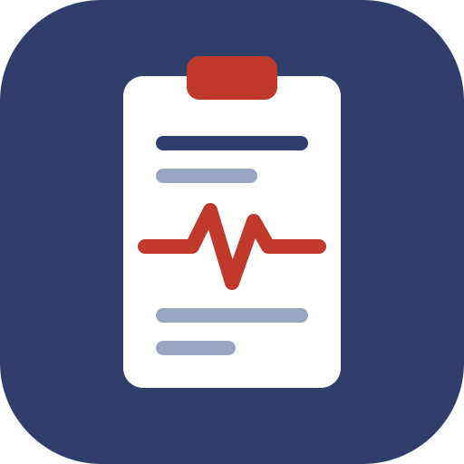
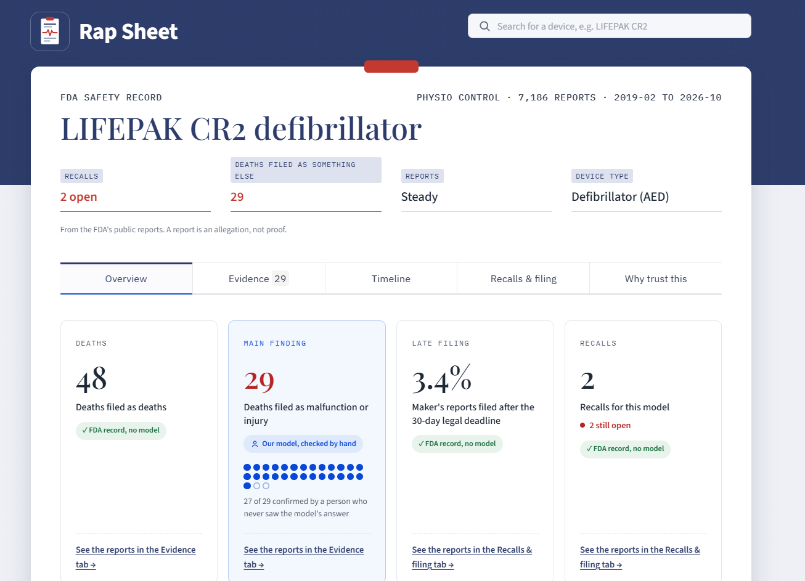
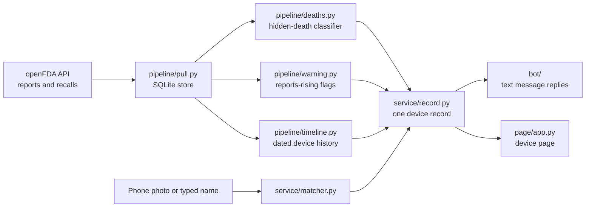

<h1>&nbsp;Rap Sheet</h1>

*The safety record of the device you depend on.*

**Text a photo of an AED or CPAP machine label. Get back its FDA safety record, with every number traceable to the original report.**

Rap Sheet turns the FDA's public adverse event and recall data into a plain-language record for one device: recalls, deaths, deaths filed under the wrong category, how late the manufacturer reports problems, and whether reports are rising. It answers by text message and links to a device page where every figure opens the FDA records it was counted from.

**Live demo:** [54-172-47-121.sslip.io](https://54-172-47-121.sslip.io) · example: [LIFEPAK CR2 defibrillator](https://54-172-47-121.sslip.io/?d=physio--lifepak-cr2-defibrillator)



**Why the name.** A rap sheet is the record a person carries of every time they were reported or charged. Medical devices have one too: the FDA's file of every problem ever reported about them. As with a person's record, an entry is an allegation, not a verdict, which is why every number here links to the report behind it.

Built at HackPrinceton Fall 2026 · Healthcare track · Special tracks: Arlequin AI (AI-Driven Forensics), Photon, ChatOverflow

---

## Contents

- [Key results](#key-results)
- [Who it is for](#who-it-is-for)
- [The problem](#the-problem)
- [How it works](#how-it-works)
- [Methods](#methods)
- [Trust and auditability](#trust-and-auditability)
- [Getting started](#getting-started)
- [Reproducing the results](#reproducing-the-results) and tests
- [Repository layout](#repository-layout)
- [Limitations and responsible use](#limitations-and-responsible-use)
- [Team](#team)
- [License](#license)
- [Sources](#sources)

---

## Key results

All figures are measured on public openFDA data: 420,167 adverse event reports for automated external defibrillators (AEDs, product code MKJ) and CPAP/BiPAP machines (BZD), received January 2019 to November 2026, and 419 recalls. Full tables are in [`eval/metrics.md`](eval/metrics.md).

| Measure | Result |
|---|---|
| Hidden-death classifier, precision on a hand-checked set | **0.93** (right 27 times out of 29 flags) |
| Hidden-death classifier, recall on the same set | 0.44 (tuned for precision on purpose) |
| Agreement between the two human checkers | 27 of 30 shared reports, Cohen's kappa **0.78** |
| Keyword search for death words, precision | 0.44 |
| FDA patient-outcome field says "Death", precision | 0.50 |
| LIFEPAK CR2 defibrillator: reports that involve a patient death but were not filed as deaths | **29 of 77** (more than 1 in 3); 16 of the 29 arrived in 2024 and 2025 |
| Manufacturer reports filed within the 30-day legal deadline | 68.9% for 2019 to 2022; 54.4% across all years (includes follow-up reports, which overstates lateness) |
| Recalls preceded by a "reports rising" flag in the prior 24 months | 48.9%, against 35.8% for random windows |

The classifier trades recall for precision deliberately: a wrong "hidden death" on a public page does more harm than a missed one. When it flags a report, it is right as often as a large language model reading every report, at no per-report cost.

---

## Who it is for

**People who own or rely on a device.** The gym manager with an AED on the wall, or someone with a CPAP machine at home. They text a photo and learn in seconds whether the device has an open recall, what to ask the manufacturer, and they can ask to be alerted if that changes. Often nobody tells them today: public-access AEDs frequently are not registered to the people responsible for them.

**People who investigate.** Journalists, regulators and hospital buyers. They open the same record and see what the official death count misses, a timeline of reports and recalls, how the device compares with every other model of its type, and the evidence behind each flag. The Rap Sheet Investigator answers their questions with a case file in which every claim cites an FDA report.

---

## The problem

- **Deaths are filed under the wrong category.** A published review of the FDA's device database estimated that about 17% of reports in which the patient died were filed as "injury", "malfunction", "other" or left blank instead of "death" [1]. Anyone who counts only the FDA's "Death" field never sees them.
- **Manufacturers report late.** Federal rules give manufacturers 30 days to report a death or serious injury [3], and published work finds a large share of reports arrive after that deadline [2].
- **Owners are often not told.** Public-access AEDs frequently are not registered to the people responsible for them, so a gym or school is often the last to hear about a recall.

The data to see all of this is public. It is just not readable by the people who rely on these devices.

---

## How it works



**1. Ask.** A user texts a device name or a photo of its label over iMessage (via the Photon API). For a photo, a vision model reads only the printed brand, model and maker into a fixed JSON schema. Our own search then matches that text to a device family, and the user confirms with YES before any record is shown.

**2. Answer.** The bot replies with the device's record:

```text
LIFEPAK CR2 defibrillator (Physio Control)
2 recalls on record, latest 2025-07-22 (Open, Classified).
7,186 reports to the FDA since 2019.
48 are coded as deaths.
29 more reports describe a patient death but were filed as a malfunction or injury,
e.g. report 0003015876-2025-01542: "the patient associated with the reported event did not survive".
This maker filed 3.4% of its reports after the 30-day legal deadline.
Full record: <device page link>
A report is an allegation, not proof the device caused harm.
Keep an AED in service unless the manufacturer says otherwise.
Reply MORE, SAVE or STOP.
```

| Command | What it does |
|---|---|
| `MORE` | Shows the reports behind the hidden-death count, with report numbers |
| `SAVE <name>` | Adds the device to a watch list; the user is texted if a new recall or a rise in reports appears |
| `STOP` | Removes the user and all saved devices |

**3. Verify.** The link opens the device page, in five tabs:

| Tab | What it shows |
|---|---|
| Overview | The four headline numbers; every death as one dot, split into filed as deaths and filed as something else; deaths per year; this device among every other model of its type; the strongest piece of evidence |
| Evidence | Each flagged report with a "why this was flagged" card, and the full lists behind the other counts |
| Timeline | Reports per month with recalls and unusual jumps marked, and the events in order |
| Recalls & filing | Each recall with the words that matched it to the device, and how late the maker files compared with other makers |
| Why trust this | How the numbers were checked by hand, the methods compared, and the model's known errors and limits |

Any tab can be linked directly, for example `?d=<device_key>&tab=evidence`. For the LIFEPAK CR2, 29 of the 77 reports that involve a patient death were not filed as deaths, and 16 of those 29 arrived in 2024 and 2025.

---

## Methods

### Data

Reports and recalls are downloaded from the [openFDA device API](https://open.fda.gov/apis/device/) one month at a time (days, for months above the API's paging limit) and stored in SQLite. Re-running the download updates rows in place, so model outputs stored on the same rows are kept.

### Device matching

Filers type brand names freely, so one device appears under many spellings. Typed words must match whole words in the brand or maker; among full matches, the device family with the most reports ranks first. When no single match is clearly ahead, the bot asks the user to choose rather than guessing.

### Recall matching

The FDA lists recalls by product code, not by model. A recall is linked to a device when its description names the maker and the device's core model phrase, with generic words such as "defibrillator" ignored. One rule ([`pipeline/match.py`](pipeline/match.py)) is shared by the page, the bot, the timeline and the backtest, so every part reports the same recalls.

### Late reporting

A date rule, not a model: days from the date the manufacturer became aware of an event to the date the FDA received the report. More than 30 days is late (21 CFR 803.50). Shares use only reports where both dates are present.

### Hidden-death classifier

Finds reports not coded as a death whose text says the patient died.

- **Model.** Each narrative is split into short passages. A sentence-embedding model (`all-MiniLM-L6-v2`) and word features feed a logistic regression; a report's score is its highest passage score. It runs on a laptop CPU over all 414,478 reports not coded as deaths.
- **Training labels.** 2,675 reports labelled by a large language model.
- **Evaluation.** A separate gold set of 200 reports, sampled across score ranges and labelled by two people who never saw any model's answer. 30 reports were labelled by both to measure agreement. "Cannot tell" answers and disagreements are excluded, leaving 181 reports, 62 of which describe a death.

| Method, on the same 181 hand-checked reports | Precision | Recall |
|---|---|---|
| Any death-related word | 0.44 | 0.95 |
| FDA outcome field says "Death" | 0.50 | 0.32 |
| **Our classifier** | **0.93** | **0.44** |
| Large language model reading every report | 0.93 | 0.90 |

Keywords fail because AED reports talk about "dead" batteries and "expired" pads, and CPAP reports carry boilerplate such as "likely to cause or contribute to death". The FDA's outcome field disagrees with the event type on 225 reports, but only half of those describe this patient dying, so it is shown as a data-quality signal, not as a death count.

### Reports rising

A month is flagged when a device's report count is far above its own previous 12 months (robust z-score of 3 or more, at least 5 reports). In a backtest, 48.9% of testable recalls had a flag in the prior 24 months, against 35.8% for random windows, with a median lead of 12 months; 79.2% of flags were not followed by a recall. The signal is real but weak, so it is worded as "reports are rising", never as a prediction of a recall.

---

### Rap Sheet Investigator

For investigators, reporters and regulators: ask a safety question in plain words, and a deep agent built with LangChain `deepagents` answers with a cited case file.

1. It plans the work as a to-do list.
2. It searches the 420,167 FDA reports through read-only tools: find devices, read a device record, list flagged reports with their explanations, read a report's full text, recalls and maker lateness.
3. An evidence-checker subagent re-reads every report the agent plans to cite.
4. It writes a short case file in which every claim links to an FDA report. Plain code then confirms that each cited report exists and states what is claimed.

```bash
streamlit run page/ask.py                      # saved investigations; set ENABLE_ASK=1 for live questions
python -m agent.investigator "Which AEDs have the most deaths filed as malfunctions?"
```

---

## Trust and auditability

Every number on the page can be checked by the person reading it.

- **Better than a keyword search.** On the same hand-checked reports, searching for death words gives 134 hits and 75 are wrong ("the battery was dead", "the pads expired"). On the same set, the classifier flagged 29 and was wrong on 2.
- **Every figure has its source rows.** The Evidence tab lists the exact reports behind each headline number, each linked to the FDA's report page and to the raw openFDA record. The full set can be downloaded as CSV.
- **Every flag is explained.** For each hidden-death flag, [`pipeline/explain.py`](pipeline/explain.py) records the passage the model scored highest, the words that pushed the score up or down (exact contributions, since the model is linear), and the most similar confirmed reports, marked as confirmed by a person or by a large language model.
- **Three witnesses.** For each report, the FDA's event type, its patient-outcome field and the narrative text are shown side by side, with disagreements highlighted.
- **Confidence means something.** Scores are calibrated against hand-checked reports, so "high confidence" reads as "right N times out of M".
- **Text messages carry their reasons.** A hidden-death claim quotes one report's sentence and report number, so it can be verified from the phone.
- **Reproducible and light on compute.** One command rebuilds everything from the public API. The classifier runs on a laptop CPU with no per-report cost, and the full dataset ships as an 31 MB file.
- **Public data only.** No patient identities. The hosted copy of the data contains no user data.
- **Methods are stated, not hidden.** The page lists how each number was produced and what it cannot show.

---

## Getting started

### Prerequisites

- Python 3.11 or newer
- An [openFDA API key](https://open.fda.gov/apis/authentication/) (free; needed for large pages)
- For messaging: a [Photon](https://photon.codes) project with an iMessage line
- For label photos: an API key for the vision model used by [`service/matcher.py`](service/matcher.py)
- Optional, to serve the page from a laptop over a public link: [`cloudflared`](https://developers.cloudflare.com/cloudflare-one/connections/connect-networks/downloads/)

### Install

```bash
git clone https://github.com/HackathonPrinceton/rapsheet.git
cd rapsheet
pip install -r requirements.txt
cp .env.example .env
```

### Configure

| Variable | Purpose |
|---|---|
| `OPENFDA_API_KEY` | openFDA access; pages of 1,000 instead of 100 |
| `PHOTON_API_KEY` | Photon project key (`pho_sk_...`) |
| `PHOTON_PROJECT_ID` | Photon project id (`pho_prj_...`) |
| `ANTHROPIC_API_KEY` | Vision model access for reading label photos |
| `RAPSHEET_VISION_MODEL` | Name of the vision model that reads label photos |
| `LABEL_MODEL` | Name of the model used to label training data (needed only to relabel) |
| `AGENT_MODEL` | Name of the model the Investigator uses (needed only for live questions) |
| `ENABLE_ASK` | `1` allows live Investigator questions; `0` (default) shows saved investigations only |
| `PAGE_BASE_URL` | Public address of the device page that bot replies link to |

### Build the data

```bash
python -m pipeline.pull --codes MKJ --start 2019-01      # AEDs; add BZD for CPAP machines
python -m pipeline.warning                               # reports-rising flags
make scores                                              # load classifier scores computed elsewhere (AED and CPAP files)
```

### Run

```bash
python start_demo.py
```

When `PAGE_BASE_URL` already points at a hosted page, this starts only the messaging bot. With `--tunnel` (or when no hosted page is set) it also starts the page on this machine, opens a public HTTPS tunnel to it and writes that address to `PAGE_BASE_URL`. Each part can also run alone:

| Command | What it runs |
|---|---|
| `streamlit run page/app.py` | Device page at `http://localhost:8501` (`?d=<device_key>` opens one device) |
| `python -m bot.photon_bot` | Messaging bot |
| `python -m bot.photon_bot --local` | The same conversation in a terminal, no keys needed |
| `uvicorn service.api:app --port 8000` | JSON API: `/search?q=` and `/device/{device_key}` |
| `python -m bot.alerts --dry-run` | Shows which watch-list alerts would be sent |

### Hosting the page

The live demo runs on one small AWS EC2 instance: Streamlit behind Caddy for HTTPS. It needs no database setup. When the full database is absent, the page unpacks [`data/rapsheet_demo.db.gz`](data/rapsheet_demo.db.gz), a compact copy built by `python -m pipeline.make_demo_db` that keeps full text only for the reports the page quotes and holds no user data. Install with `pip install -r page/requirements.txt`, which lists only what the page needs.

Without a database or the demo copy, the API and page serve [`data/sample_record.json`](data/sample_record.json), a made-up record for development that is labelled as such.

---

## Reproducing the results

```bash
make pull                       # download reports and recalls (about 50 minutes with a key)
make models                     # train and score the classifier, run the backtest
python -m pipeline.evaluate     # score all methods against the hand-checked gold set
python -m pipeline.explain      # write per-flag explanations and calibration
```

Inputs and outputs of the evaluation are committed under [`eval/`](eval/): training labels, the blind hand-check set with both checkers' answers, and the resulting metrics. [`eval/README.md`](eval/README.md) explains every file.

### Tests

```bash
make test        # or: python -m pytest -q tests
```

13 tests cover the late-filing rule, name cleaning, recall matching, the keyword baseline's known failures, the agreement measure, the reports-rising detector, and an end-to-end path from search to bot reply to the rendered page.

---

## Repository layout

```text
rapsheet/
├── pipeline/           data and models
│   ├── pull.py           download reports and recalls; late-reporting rule
│   ├── store.py          SQLite schema and name cleaning
│   ├── deaths.py         hidden-death classifier: sample, train, score
│   ├── evaluate.py       compare methods on the hand-checked gold set
│   ├── explain.py        per-flag explanations and calibration
│   ├── warning.py        reports-rising flags and recall backtest
│   ├── timeline.py       dated history per device
│   ├── match.py          shared recall-to-device rule
│   ├── deathwords.py     shared death-word lists (keyword baseline, quoting, highlighting)
│   ├── paths.py          where every evaluation file lives
│   ├── make_demo_db.py   build the compact database the hosted page uses
│   └── import_scores.py  load scores computed on another machine
├── service/            device records
│   ├── record.py         build one device's record and its audit views
│   ├── matcher.py        typed text or label photo to a device
│   └── api.py            JSON API
├── bot/                messaging
│   ├── photon_bot.py     iMessage connection via Photon
│   ├── chat.py           conversation logic, testable without a network
│   ├── replies.py        every message the bot sends
│   ├── watch.py          watch list
│   └── alerts.py         recall and reports-rising alerts
├── agent/              Rap Sheet Investigator (LangChain deepagents): tools, agent, saved examples
├── page/
│   ├── app.py            device page
│   ├── ask.py            Investigator page
│   └── gold_check.py     blind hand-labelling tool for the hand-check set
├── eval/               results, the blind hand-check and training labels (see eval/README.md)
├── tests/              unit and end-to-end tests
├── data/               compact demo database, a sample record; the full database is local and not committed
├── assets/             logo
├── docs/               screenshots
└── start_demo.py       one command for a full demo
```

---

## Limitations and responsible use

- **A report is an allegation.** An adverse event report does not prove that a device caused harm. Rap Sheet says "reports describe a death", never "this device killed".
- **No medical advice.** Rap Sheet never tells anyone to stop using a device. It points to the recall notice, the manufacturer and the user's doctor. AED replies add "Keep it in service unless the manufacturer says otherwise."
- **Scope.** Two device types, chosen for the hackathon. Figures for other devices will differ.
- **Matching is imperfect.** Brand names vary by filer, so some reports for a device may sit under another spelling, and recall links rely on wording.
- **The classifier misses deaths.** Recall is 0.44 by design. Its counts are a lower bound, and every flagged report can be read in full.
- **Privacy.** All data is public and contains no patient identities. The bot stores only a contact handle and the devices a user chose to save, and `STOP` deletes both.

---

## Team

| Name | Focus |
|---|---|
| Mrudula ([@mrudulaeluri29](https://github.com/mrudulaeluri29)) | Messaging bot, label matcher, alerts, device record service, device page and audit views |
| Krutika Anaganti ([@kanagant](https://github.com/kanagant)) | Data pipeline, hidden-death classifier, evaluation and explanations, reports-rising backtest, page explainability views |

---

## License

Released under the [MIT License](LICENSE).

---

## Sources

1. Lalani C, et al. *JAMA Internal Medicine*, 2021. Review of FDA device reports describing a patient death that were filed in categories other than death.
2. Everhart et al. *BMJ*, 2025. Timeliness of manufacturer adverse event reporting to the FDA.
3. Medical Device Reporting, 21 CFR Part 803 (803.50: 30-day reporting requirement for manufacturers).
4. U.S. Food and Drug Administration. [openFDA device adverse event and recall APIs](https://open.fda.gov/apis/device/).
